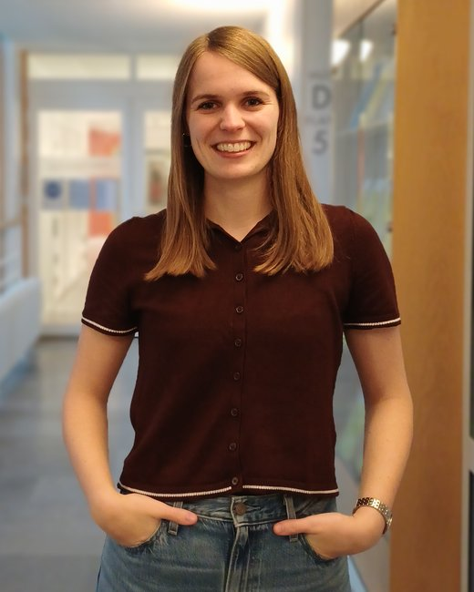

```{=html}
<div class="home-wrap plain">
  <div class="home-grid">
    <div class="home-side">
      
      <div class="contact">
        Department Corporate Development<br>
        University of Cologne<br>
        paula.scholz[at]wiso.uni-koeln.de
      </div>
      <div class="home-links">
        <a href="CV_Paula_Scholz_Academic_Nov26.pdf" target="_blank"><i class="bi bi-file-earmark-text"></i>CV (PDF)</a>
        <a href="https://www.linkedin.com/in/paula-scholz-217162221/" target="_blank"><i class="bi bi-linkedin"></i>LinkedIn</a>
      </div>
    </div>

    <div class="home-main">
      <h1 class="plain-name">Paula Scholz</h1>
      <p class="plain-sub">PhD Candidate in Economics · University of Cologne</p>

      <h2 class="section-head">About Me</h2>

      <p>I am a PhD Candidate in the <a target="_blank" href="https://cd.wiso.uni-koeln.de/en/team/personnel-economics-and-human-resource-management">Department Corporate Development</a> at the University of Cologne and a member of <a target="_blank" href="https://c-seb.de/">C-SEB</a> and <a target="_blank" href="https://econtribute.de/">ECONtribute</a>.</p>

      <p>My research focuses on topics in organizational, gender and behavioral economics. In particular, I am interested in inequalities in labor markets and organizations. To study these aspects, I conduct field experiments in organizations as well as laboratory experiments.</p>
      
      <p>In November 2026, I am visiting the <a target="_blank" href="https://www.gu.se/en/economics">Department of Economics</a> at the University of Gothenburg, hosted by <a target="_blank" href="https://sites.google.com/site/josephvecci/home">Joe Vecci</a>. I  previously visited the department from September to November 2025. In December 2026, I will visit <a target="_blank" href="https://www.econ.lmu.de/en/index.html">Ludwig-Maximilians-Universität München</a>, hosted by <a target="_blank" href="https://sites.google.com/view/florianenglmaier">Florian Englmaier</a>. </p>

      <p class="fields">Fields: Organizational Economics, Gender Economics, Behavioral Economics</p>
    </div>
  </div>
</div>
```
